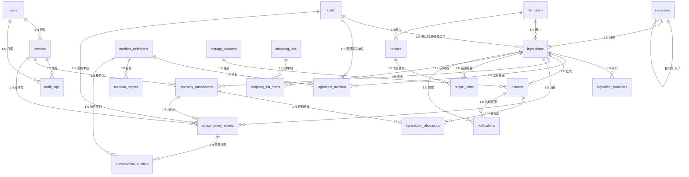
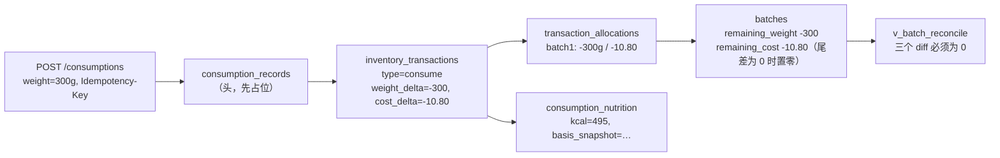

# 数据库 ER 图与关系说明

> 权威 DDL 见 `database/001_init.sql`；逐字段说明见 `docs/database.md`。
> 生成方式：手绘 mermaid（仓库内可直接渲染），非数据库反向工程。

---

## 1. 全局 ER 图

---

## 2. 核心链路放大：一次消耗如何落库

**一笔消耗 = 1 头 + 1 流水 + N 分配 + N 营养快照**，全部在同一事务内；
撤销 = 新增一条 `type=reverse` 的流水与**符号相反**的分配，并把 `consumption_records.status` 改为 `reversed`，
原记录与快照一律不删。

---

## 3. 关系清单（含基数与判定依据）

| # | 关系 | 基数 | 说明 |
| --- | --- | --- | --- |
| 1 | `users → devices` | 1:N | 单用户多设备；设备吊销后令牌即时失效 |
| 2 | `categories → categories` | 1:N 自引用 | 两级分类；同级不重名由两条 partial unique index 保证 |
| 3 | `categories → ingredients` | 1:N | 分类删除用 `RESTRICT`，先归零食材再删 |
| 4 | `units → ingredients` | 1:N ×2 | 数量单位与重量单位各一个外键；`dimension` 决定不可混用 |
| 5 | `ingredients → ingredient_barcodes` | 1:N | 一个食材可有多个条码；条码全局唯一 |
| 6 | `ingredients → ingredient_nutrition` | 1:N | 每项目**同时只有一条** `is_current`（partial unique） |
| 7 | `nutrition_definitions → ingredient_nutrition / targets / consumption_nutrition` | 1:N ×3 | 项目字典被三处引用，删除必须 `RESTRICT` |
| 8 | `ingredients → batches` | 1:N | 批次是"哪一次买的"，永不覆盖历史 |
| 9 | `batches → transaction_allocations` | 1:N | 一个批次被多笔流水分摊过 |
| 10 | `inventory_transactions → transaction_allocations` | 1:N | 一笔消耗可拆到多个批次（FEFO） |
| 11 | `inventory_transactions ↔ consumption_records` | **1:1** | `consumption_records.transaction_id` 上有 UNIQUE |
| 12 | `consumption_records → consumption_nutrition` | 1:N | 每个营养项目一条快照，`UNIQUE(consumption_id, nutrition_definition_id)` |
| 13 | `consumption_records → inventory_transactions` | 1:1 可选 | `reversed_by_transaction_id` 指向冲销流水 |
| 14 | `batches → storage_locations` | N:1 | 位置可空（未指定） |
| 15 | `shopping_lists → shopping_list_items` | 1:N | 删除清单级联删项 |
| 16 | `recipes → recipe_items` | 1:N | 同上 |

**为什么 `transaction_allocations` 必须有 `UNIQUE(transaction_id, batch_id)`**：
同一笔流水对同一批次只应有一条分配。若允许多条，`SUM(weight_delta)` 仍然正确，但"这笔消耗在这个批次扣了多少"会被拆碎，
撤销时容易漏项；唯一约束把这个不变量交给数据库而不是代码。

---

## 4. 状态机

| 表 | 字段 | 取值 | 迁移规则 |
| --- | --- | --- | --- |
| `batches` | `status` | `active` → `depleted` | `remaining_weight = 0 AND remaining_quantity = 0` 时由服务层置 `depleted`；不允许从 `depleted` 回到 `active`（要回补请新建批次） |
| | | `active` → `void` | 录错批次时作废，需先冲销其全部分配 |
| `consumption_records` | `status` | `completed` → `reversed` | 撤销后不可再撤销；`reversed_by_transaction_id` 由 CHECK 与状态绑定 |
| `shopping_lists` | `status` | `open` → `completed` → `archived` | 完成后可归档，归档只读 |
| `notifications` | `status` | `pending` → `scheduled` → `sent` / `skipped` | App 拉取时把 `pending` 排成本地通知并置 `scheduled`；用户已处理或批次无库存则 `skipped` |
| `ingredient_nutrition` | `is_current` | `true` → `false` | 改营养值时「插入新版本 + 旧版本置 false」，同一事务完成 |

---

## 5. 图与实现的对应关系（防止图漂移）

| 图上元素 | 实现位置 |
| --- | --- |
| 实体与字段 | `database/001_init.sql` 的 `CREATE TABLE` |
| 关系（连线） | 各表的 `REFERENCES`；删除策略见 DDL 中的 `ON DELETE` |
| 唯一性/约束 | DDL 中的 `UNIQUE`、`CHECK`、partial unique index |
| 视图 | `v_inventory`、`v_batch_reconcile` |
| 状态机 | `ck_*` CHECK 约束 + 服务层状态迁移函数（M3 实现） |

> 修改表结构时的顺序：先改 `001_init.sql` → 在本地库重建 → 更新本文档的 ER 图与关系表 → 再写服务层。
> 三者不一致视为缺陷（见 `AGENTS.md` 的"文档同步"规则）。
